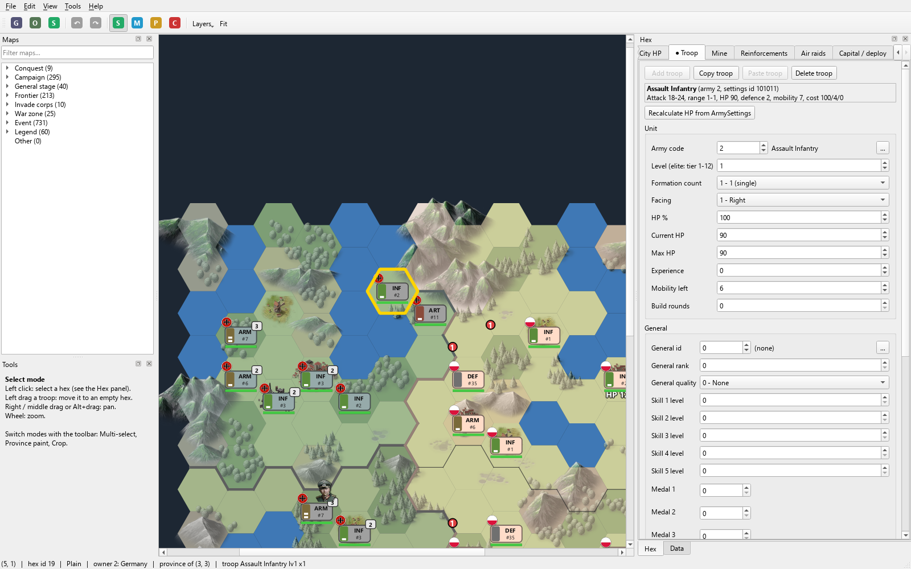
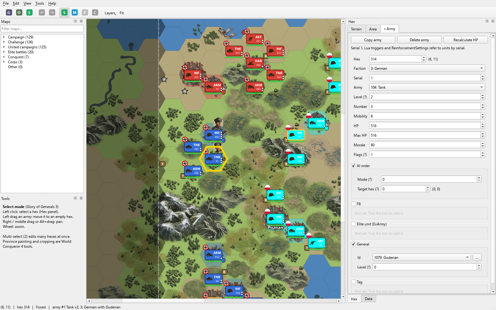
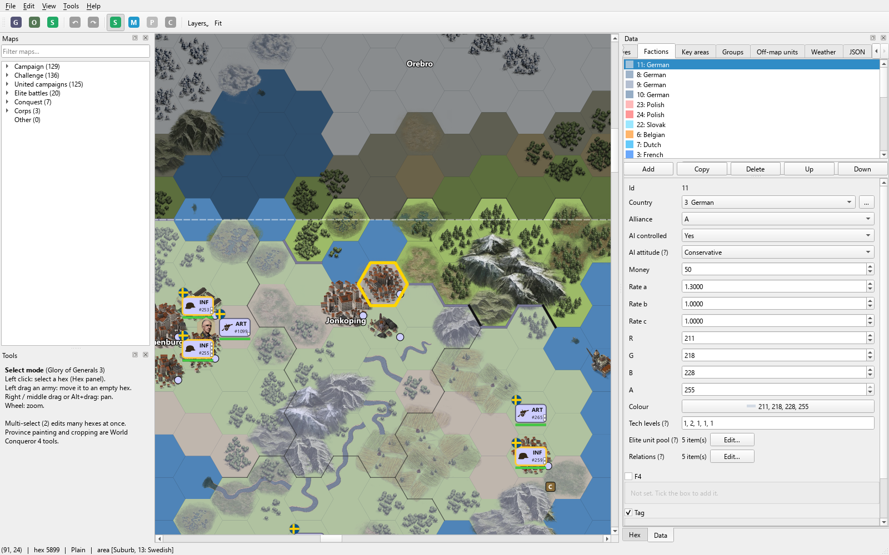
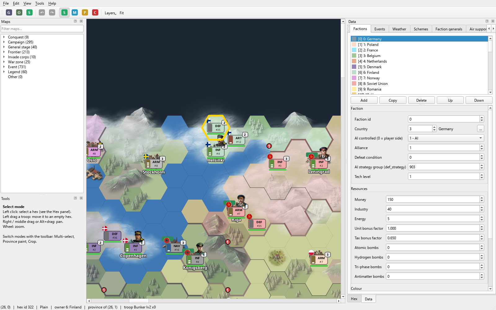
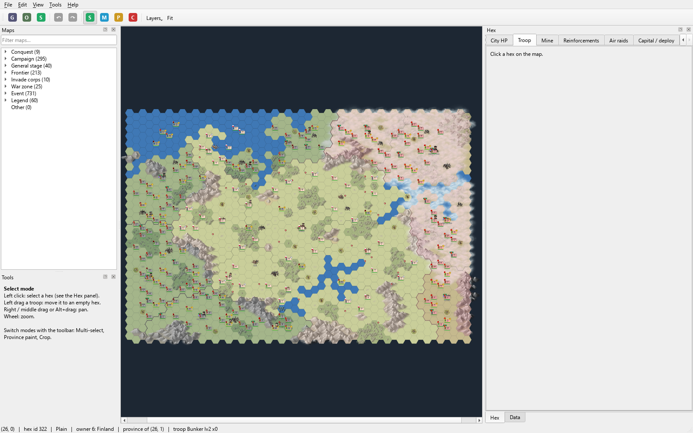

<div align="center">

# EasyTech BTL Editor

**A visual battle-map editor for EasyTech strategy games: edit `.btl` maps on a hex map instead of in a hex editor.**

[](https://github.com/ReactionaryGod/easytech-btl-editor/actions/workflows/ci.yml)

-41CD52?logo=qt&logoColor=white)

[](LICENSE)




</div>

EasyTech (World Conqueror, Glory of Generals, European War, Great Conqueror, …) stores every battle in `.btl`
files: factions, terrain, cities, units, generals, reinforcements, events and weather, packed as binary data. This
editor draws the map with the game's own art and lets you click a hex to edit what's on it.

> **Supported games**, in the same window:
> - **World Conqueror 4** v1.30.0: all 1383 shipped maps (format versions 1, 2 and 3).
> - **Glory of Generals 3**: all 420 shipped maps (FlatBuffers format, see [below](#glory-of-generals-3)).
>
> Point **File › Set game folder…** at either game and the editor detects which one it is. See
> [Other EasyTech games](#other-easytech-games) for the rest.

## Features

### World Conqueror 4

- 🗺️ **Map browser:** every map in the game's `stage/` folder, grouped by mode (Conquest, Campaign, General stage, Frontier, Invade corps, War zone, Event, Legend), with campaign names and a filter box.
- 🎨 **Real game rendering:** terrain and plant sprites, ownership colours and borders, cities and capitals, flags and general portraits, read from the game's own atlases. Each layer can be switched off.
- 🖱️ **Hex panel:** click a hex to edit its land, city, city HP, troop, mine, reinforcements, air raids and capital or deploy slots. Add, copy, paste and delete on every tab.
- 🪖 **Searchable pickers** for army types, generals and countries. Picking a general fills in rank, quality and skill levels.
- ✋ **Drag a troop** onto another hex to move it.
- 🧰 **Multi-select:** create or delete troops, cities and mines, set the owner or province, or set any troop or city field across many hexes at once.
- 🖌️ **Province painting:** paint which hexes belong to a city, then apply.
- ✂️ **Crop:** save any rectangle of a map as a new standalone map.
- 📋 **Data panel:** header, factions (colour picker, resources, 53 tech levels, reorder), events, weather, schemes, faction generals, air support and deploy slots.
- ↩️ **Undo/redo**, a `.bak` copy before the first save, and an optional `ch_battle.bin` MD5 update (WC4 1.30.0 doesn't check it, but it keeps the table in sync).
- 🌐 Game text in any of the game's 7 languages; field labels in English or the original Chinese.

### Glory of Generals 3

- 🗺️ **Map browser:** Campaign, Challenge, United campaigns, Elite battles, Conquest and Corps maps, with their in-game titles.
- 🎨 **Real game rendering:** ground and sea, all three terrain-sprite layers (decorations, forests/mountains/rivers, canopies/peaks), buildings with their snow and variant sprites, ownership tint and province borders on conquest maps, key areas, fortifications, army icons, flags and general portraits. The playable rectangle is outlined and hexes outside it are shaded.
- 🖱️ **Hex panel:**
  - **Terrain:** ground, tile, sea, disabled and other flags, and each sprite layer's terrain, tile and offset.
  - **Area:** city name, building (owner, type, style, variant), fortification and key area.
  - **Army:** type, faction, number, HP, morale, mobility, general, elite unit and AI order. You can also add, copy, paste or delete an army, or recalculate its HP.
- 📋 **Data panel:** objectives (with the game's objective texts), factions (colour, alliance, AI, money, tech, elite pool, relations), key areas, groups, off-map units (reinforcement pool), weather and map settings. The **JSON** tab edits any section, including fields whose meaning is still unknown.
- 🧰 **Multi-select:** add or delete armies, set an army field, delete areas, set ground, and switch sea or disabled on or off.
- ✋ Drag armies to move them; undo/redo, `.bak` backups, and a `ch_battle.bin` MD5 update when that file exists (same layout as WC4's).

<table>
<tr>
<td></td>
<td></td>
</tr>
<tr>
<td align="center">GoG3: Blitzkrieg, editing Guderian's tank army</td>
<td align="center">GoG3: Western Front 1939 conquest map, faction data</td>
</tr>
<tr>
<td></td>
<td></td>
</tr>
<tr>
<td align="center">WC4: faction resources, colours and tech in the Data panel</td>
<td align="center">WC4: a whole event map at a glance</td>
</tr>
</table>

## Getting started

You need Python 3.10 or newer and your own copy of the game, unpacked (the editor ships no game files).

**Windows:** double-click `run.bat`. The first run creates a `.venv` and installs PySide6.

**Any OS:**

```bash
python -m venv .venv
.venv/bin/pip install -r requirements.txt      # Windows: .venv\Scripts\pip
.venv/bin/python app.py [path/to/map.btl]
```

Then use **File › Set game folder…** and point it at the unpacked APK of World Conqueror 4 or Glory of Generals 3:
the folder that contains `assets/`, or `assets/` itself. The editor reads `assets/stage/*.btl`, the
`*Settings.json` tables, the string tables, the terrain definitions and the texture atlases from there.

> ⚠️ Saving writes into your game folder. The editor keeps a `.bak` of each map the first time you save it, but back up
> the folder before big edits.

### Shortcuts

| Key | Action |
|---|---|
| `1` / `2` / `3` / `4` | Select / Multi-select / Province paint / Crop mode (3 and 4: WC4 only) |
| `Ctrl+Z` / `Ctrl+Y` | Undo / redo |
| `Ctrl+O` / `Ctrl+S` / `Ctrl+Shift+S` | Open / save / save as |
| `Ctrl+=` / `Ctrl+-` / `Ctrl+0` | Zoom in / out / fit |
| Wheel | Zoom |
| Right or middle drag, `Alt`+drag | Pan |

## How it compares with EModule

The design follows **EModule 0.1.3's BtlEditor**, an Android `.btl` editor. This is an independent desktop
rewrite with no activation code or login. Its file handling was checked against every WC4 map, which surfaced
several problems the original has:

| Issue in EModule | Here |
|---|---|
| War zone (v2) maps read with 80-byte reinforcements | Correct 104-byte records |
| The header-27 section and v3 trailing bytes are dropped while their counts stay in the header, corrupting the map | Both kept byte-for-byte |
| Every faction id rewritten to its list position | Ids never renumbered |
| Mine HP read as an i32, absorbing the army code | `u16 hex, owner, level, HP, army (33/34), pad` |
| Schemes keyed by target hex, duplicates lost | Kept as a list |
| Every section re-sorted into hex order on save | Original record order kept |

Loading and saving any shipped map without edits gives a **byte-identical file**.

## The `.btl` format

All record layouts, with the original Chinese field names next to English ones, are in
[`wc4btl/btlfile.py`](wc4btl/btlfile.py). In short:

```
header → factions → terrain (own-terrain maps only) → province u16[n] → owner u8[n]
→ cities → troops → mines → schemes → weather → events → reinforcements → air raids
→ deploy A → deploy B → capitals → header-27 section → faction generals → air support → tail (v3)
```

- Version 1 uses 48-byte troops and 80-byte reinforcements. Versions 2 and 3 use 64 and 104 bytes.
- Maps with `map_index ≠ 0` sit on the 148 × 54 world grid from `world.bin`. Their hex references are world hex ids
  `(y + crop_y) × 148 + (x + crop_x)`.
- Owner bytes hold faction **indexes**. Every other faction reference holds faction **ids**.
- Hexes are flat-topped, with odd columns shifted down half a row (odd-q).

## Project layout

```
app.py                 entry point
wc4btl/btlfile.py      .btl reader/writer (all record types)
wc4btl/worldbin.py     world.bin (world terrain + provinces)
wc4btl/gamedata.py     game tables, stringtables, atlases, terrain config
wc4btl/model.py        per-hex document, edit operations, undo, crop, save
wc4btl/ui/             Qt interface (map view, hex/data/tool panels, dialogs)
gog3btl/format.py     Glory of Generals 3 .btl (FlatBuffers) schema, reader and writer
gog3btl/gamedata.py   GoG3 tables, string tables, terrain definitions, atlases
gog3btl/model.py      GoG3 per-hex document, edit operations, undo, save
gog3btl/ui/           GoG3 map painter, hex/data/tool panels, forms (plugged into the shared window)
gog3btl/__main__.py   GoG3 command line (info / dump / build)
docs/                  format notes (gog3-btl-format.md) and screenshots
tests/                 format tests (no game needed) + round-trip / model / UI tests (need the game)
```

## Tests

```bash
python -m unittest discover -s tests -p "test_*format.py"   # no game files needed; runs in CI
python tests/test_roundtrip.py "<game>/assets/stage"         # every map must re-save byte-identical
python tests/test_model.py "<game>"                          # edit operations + undo
python tests/smoke_ui.py <screenshot-dir>                    # headless UI run
python tests/test_gog3_roundtrip.py "<gog3>/assets/stage"    # GoG3: read, rebuild, read back
python tests/test_gog3_model.py "<gog3>"                     # GoG3: edit, save, reload, undo on every map
python tests/smoke_ui_gog3.py <screenshot-dir> "<gog3>"      # GoG3 headless UI run
```

## Glory of Generals 3

GoG3's `.btl` files are a different kind of file from WC4's. They are **FlatBuffers** buffers, and the game's engine
(`libiron.so`) verifies them before loading. The schema (43 table types) was recovered from the engine's own
verifier code and given field names using the game's tables, string tables and Lua trigger scripts. The full
reference is [docs/gog3-btl-format.md](docs/gog3-btl-format.md). Fields whose meaning is still unknown are shown as
`fN` (tick *Show unknown / padding fields* in Tools › Settings, or use the JSON tab), so nothing is hidden from editing.

Besides the editor, `gog3btl` works from the command line:

```bash
python -m gog3btl info  stage10101.btl            # objectives, factions, areas, units with their in-game names
python -m gog3btl dump  stage10101.btl map.json   # whole map as named JSON
python -m gog3btl build map.json stage10101.btl   # and back
```

All 420 shipped GoG3 maps read, rebuild and read back unchanged. The rebuilt files also pass the engine's verifier,
which was run in an arm64 emulator. The writer does not reproduce EasyTech's exact byte layout, so a saved map is
about 1% larger with the same content.

## Other EasyTech games

EasyTech's other strategy games also use `.btl` battle files, but the formats differ between games. WC4 dumps raw
records; GoG3 uses FlatBuffers. Supporting another game means adding a reader for its layout. Issues and pull
requests with layout notes or sample maps for other titles are welcome.

## Disclaimer

A fan-made modding tool, not affiliated with or endorsed by EasyTech. World Conqueror and all game assets belong to
their owners. This repository contains only original code and screenshots of the editor; you need your own copy of
the game. Edit only games you own.

## License

[MIT](LICENSE)
